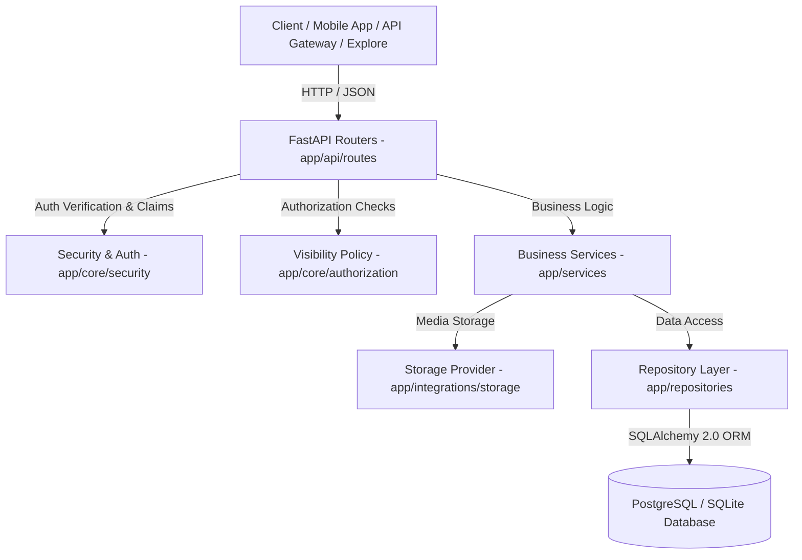

# Social Content & Post Microservice

Production-ready, highly reliable **Social Content & Post Microservice** built with Python 3.11+, FastAPI, SQLAlchemy 2.0, PostgreSQL/SQLite, Alembic migrations, Docker Compose, and Pytest.

---

## 1. Service Purpose & Boundaries

### Core Capabilities:
- **Authentication & User Identity**: Dedicated real database persistence (`users` table) with UUID `user_uuid`, unique username/email, secure bcrypt hashing, duplicate conflict handling (`HTTP 409`), and JWT issuing (`sub: user_uuid`, `user_id: canonical int`).
- **Posts**: Creation, retrieval, updates, soft deletion, caption hashtag/mention parsing, status (`active`, `hidden`, `deleted`, `under_review`), and visibility (`public`, `followers`, `private`).
- **Comments & Replies**: Nested comment hierarchy with visibility checks.
- **Likes**: Atomic like tracking with database-enforced `UNIQUE(user_id, post_id)` constraints and visibility authorization.
- **Saves / Bookmarks**: Atomic post saves with database-enforced `UNIQUE(user_id, post_id)` constraints and `/users/me/saved-posts`.
- **Media**: Streamed upload with chunk-level size enforcement (`MAX_MEDIA_SIZE_MB`), magic byte validation, path-traversal prevention, and access-controlled file streaming (`/api/v1/media/{media_id}/file`).
- **Feed**: Algorithmic & chronological feed building (`GET /api/v1/feed`) with cursor & offset pagination.
- **Explore Service Compatibility**: Fully verified against Explore microservice contracts (`GET /api/v1/posts?visibility=public`, `GET /api/v1/hashtags/{tag}/posts`, `file_url`/`url` aliases, and ISO timestamps).
- **Denormalized Engagement**: Maintained O(1) counters (`like_count`, `comment_count`, `save_count`, `share_count`) on post entities.

---

## 2. Architecture



---

## 3. Tech Stack

- **Framework**: FastAPI + Uvicorn
- **Database & ORM**: PostgreSQL 15 / SQLite via SQLAlchemy 2.0
- **Database Migrations**: Alembic
- **Validation**: Pydantic v2
- **Security**: Direct `bcrypt` password hashing, python-jose (JWT)
- **Testing**: Pytest & HTTPX
- **Containerization**: Multi-stage Dockerfile (`python:3.11-slim`), Docker Compose, non-root `appuser`

---

## 4. API Documentation

### Base URL: `/api/v1` (with legacy fallback endpoints)

| Domain | Method | Endpoint | Purpose | Auth Required |
| :--- | :--- | :--- | :--- | :--- |
| **Auth** | `POST` | `/auth/register` | Register new user account | No |
| **Auth** | `POST` | `/auth/login` | Login and receive bearer JWT | No |
| **Users** | `GET` | `/users/me` | Read authenticated user profile | Yes |
| **Health** | `GET` | `/api/v1/health/live` | Container liveness check | No |
| **Health** | `GET` | `/api/v1/health/ready` | Database readiness check | No |
| **Posts** | `POST` | `/api/v1/posts/` | Create post (derives `author_id`) | Yes |
| **Posts** | `GET` | `/api/v1/posts/{post_id}` | Get post details + engagement (Visibility protected) | Optional |
| **Posts** | `GET` | `/api/v1/posts/` | List posts (pagination, search, author, visibility) | Optional |
| **Posts** | `PUT` | `/api/v1/posts/{post_id}` | Update post (Author only) | Yes |
| **Posts** | `DELETE` | `/api/v1/posts/{post_id}` | Soft delete post (Author only) | Yes |
| **Comments** | `POST` | `/api/v1/posts/{post_id}/comments` | Add comment or nested reply | Yes |
| **Comments** | `GET` | `/api/v1/posts/{post_id}/comments` | List comments tree (Visibility protected) | Optional |
| **Likes** | `POST` | `/api/v1/posts/{post_id}/likes` | Like post (Atomic unique constraint) | Yes |
| **Likes** | `DELETE` | `/api/v1/posts/{post_id}/likes` | Unlike post | Yes |
| **Likes** | `GET` | `/api/v1/posts/{post_id}/likes/count` | Get total like count | No |
| **Saves** | `POST` | `/api/v1/posts/{post_id}/save` | Save/Bookmark post | Yes |
| **Saves** | `DELETE` | `/api/v1/posts/{post_id}/save` | Unsave post | Yes |
| **Saves** | `GET` | `/api/v1/users/me/saved-posts` | List user's saved posts | Yes |
| **Media** | `POST` | `/api/v1/posts/{post_id}/media` | Stream and attach media item | Yes |
| **Media** | `GET` | `/api/v1/media/{media_id}/file` | Access-controlled media streaming | Optional |
| **Media** | `DELETE` | `/api/v1/media/{media_id}` | Delete media item | Yes |
| **Feed** | `GET` | `/api/v1/feed/` | Fetch feed (cursor/offset pagination) | Optional |
| **Shares** | `POST` | `/api/v1/posts/{post_id}/shares` | Record post share & increment count | Yes |
| **Hashtags** | `GET` | `/api/v1/hashtags/{tag}/posts` | Get posts by hashtag | No |

---

## 5. Running & Deployment

### Quick Docker Compose Startup
```bash
cp .env.example .env
docker compose up --build -d
```
See [DOCKER_SETUP.md](docs/DOCKER_SETUP.md) for full commands.

### Local Development Startup
```bash
# Apply migrations
python -m alembic upgrade head

# Run server
python -m uvicorn app.main:app --reload --port 8000

# Run automated tests
python -m pytest -v
```